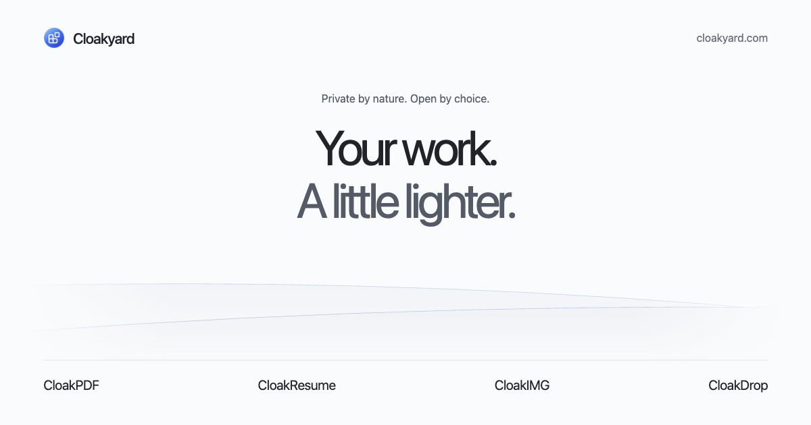

# Cloakyard

**Your work. A little lighter.**

[Website](https://cloakyard.com/) · [Source](https://github.com/cloakyard/cloakyard) · [Support](https://ko-fi.com/sumitsahoo21)

<p align="center">
    <a href="https://opensource.org/licenses/MIT"></a>
    
    <a href="https://viteplus.dev/"></a>
    
  </p>

<p align="center">
  
</p>

## Overview

The directory for CloakPDF, CloakResume, CloakIMG, CloakDrop and CloakRoll, with a separate link to KERR. Web tools process work locally; the native apps have their own documented network and storage boundaries.

## Features

### Productivity

- **[CloakPDF](https://pdf.cloakyard.com)** — edit, annotate, redact, reorganise, and export PDFs locally in the browser.
- **[CloakResume](https://resume.cloakyard.com)** — build, tailor, review, and export an ATS-friendly résumé without uploading your career history.
- **[CloakIMG](https://img.cloakyard.com)** — a private photo editor with retouching, metadata removal, and optional on-device AI.
- **[CloakDrop](https://drop.cloakyard.com)** — a native macOS download manager with adaptive range transfers and zero telemetry.
- **[CloakRoll](https://roll.cloakyard.com)** — back up original iPhone photos and videos over USB to your Mac; Apple silicon and macOS 26+.

### Explorations

- **[KERR](https://kerr.cloakyard.com)** — a relativistic black-hole visualiser with a generative cinematic score, running entirely in the browser.

Product copy, destinations, status, and icons live in one registry: [`src/data/tools.ts`](src/data/tools.ts). Add a project there and compose a matching section only when the new project needs more than a standard tool entry.

### Family artwork

One blue cube arrives per app, building an isometric grid inspired by the family
mark. A faint next cell leaves room for more. Cells come from the product registry,
so adding an app needs no bespoke artwork. The finite local SVG sequence uses the
shared Air lifecycle, stays still for reduced motion and constrained devices,
pauses offscreen and supports replay only after completion. The directory and all
actions remain available throughout; no graphics dependency or shader is loaded.

## Privacy

The directory has no accounts, analytics or runtime data API. Browsers request static website assets; each linked app owns its own processing, storage and privacy policy. Read the [website policy](https://cloakyard.com/?view=privacy).

- **Open source** — the code is part of the product and should be readable, auditable, and welcoming to improve.
- **Privacy by architecture** — local processing and minimal network surfaces come before privacy copy.
- **Design with intent** — privacy tools should also be legible, responsive, and pleasant to use.

## Getting started

Open [cloakyard.com](https://cloakyard.com/) and choose an app. Browser tools open directly; native products link to their websites and published downloads.

## Development

Requires **Node.js 24 or newer** and the Vite+ CLI.

```bash
npm install --global vite-plus
git clone https://github.com/cloakyard/cloakyard.git
cd cloakyard
vp install
vp dev
```

| Command         | Purpose                                |
| --------------- | -------------------------------------- |
| `vp dev`        | Start the local development server     |
| `vp check`      | Format and lint                        |
| `vp build`      | Create the production build in `dist/` |
| `vp preview`    | Preview the production build           |
| `vp run deploy` | Check, build, and deploy with Wrangler |

Also run `vp exec tsc --noEmit`, `node scripts/check-air-design.mjs` and `npx --yes knip@6.44.2`.

### Technology

| Area      | Technology                                                              |
| --------- | ----------------------------------------------------------------------- |
| UI        | [React 19](https://react.dev/) + TypeScript 7                           |
| Toolchain | [Vite+](https://viteplus.dev/) — dev, checks, build, package management |
| Icons     | [Lucide](https://lucide.dev/)                                           |
| Styling   | Canonical Air tokens and component CSS, native system typography        |
| Hosting   | Cloudflare Workers static assets                                        |

The production site is a small client-rendered React app. There is no router, backend, database, state library, or runtime data fetch because the homepage does not need them.

## Design and assets

This repository owns the [portable Air contract](design/air/contract.md), [reference and tokens](design/air/README.md), and [component matrix](design/air/COMPONENTS.md). The current pinned baseline is Air 1.7.2. Product copies are generated with `node scripts/sync-air-design.mjs --bundle`; verify them with `--bundle --check`.

Read [DESIGN.md](DESIGN.md) before UI changes. The [refresh ledger](UX_REFRESH_TODO.md) and [handoff](docs/air/RESUME.md) distinguish verified software coverage from open physical-device acceptance. [README guidance](docs/README_STANDARD.md) defines the family documentation structure. `artwork/og.html` and `vp run generate:og` own the local social preview.

## Project structure

```text
cloakyard/
├── public/
│   ├── cloakyard-mark.svg     # Primary brand mark and favicon
│   ├── og.png                 # 1200×630 social preview
│   ├── robots.txt
│   └── sitemap.xml
├── src/
│   ├── components/            # Header, hero, open product entries, exploration links, principles, footer
│   ├── data/tools.ts          # Tool registry and destinations
│   ├── App.tsx                # One-page composition
│   ├── styles/air.css         # Generated, pinned family foundation
│   ├── index.css              # Homepage composition and responsive layout
│   └── main.tsx               # React entry
├── index.html                 # Metadata, no-JS directory, and structured data
├── vite.config.ts             # Vite+ / React configuration
└── wrangler.jsonc             # Cloudflare Workers static-assets configuration
```

## Deployment and releases

The site builds to static assets and deploys as a Cloudflare Worker.

```bash
vp run deploy
```

For Cloudflare Workers Builds connected to Git:

1. Select the `cloakyard/cloakyard` repository.
2. Set the build command to `vp build`.
3. Set the deploy command to `vp exec wrangler deploy`.
4. Attach `cloakyard.com` as the Worker custom domain.

Pull requests can use Cloudflare preview deployments; only approved main-branch changes publish the production Worker.

Promote tested work through a `dev` → `main` PR, then update `dev` from `main`. Verify the exact main build and live assets after deployment.

## Contributing

Read [AGENTS.md](AGENTS.md), [CLAUDE.md](CLAUDE.md) and [DESIGN.md](DESIGN.md) before changes. Keep changes bounded, preserve features and output, remove obsolete references, and record actual verification. Compare all applicable views in phone, tablet, laptop and desktop layouts, both themes.

The [family README standard](https://github.com/cloakyard/cloakyard/blob/main/docs/README_STANDARD.md) defines this document's section order. Support the project through [Buy me a coffee](https://ko-fi.com/sumitsahoo21).

## License

Released under the [MIT License](LICENSE). Third-party components retain their own licenses.

Built by [Sumit Sahoo](https://github.com/sumitsahoo), part of [Cloakyard](https://cloakyard.com/).
