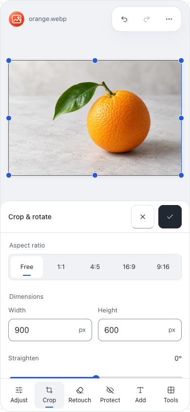
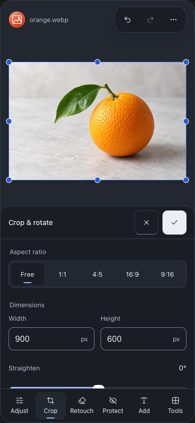
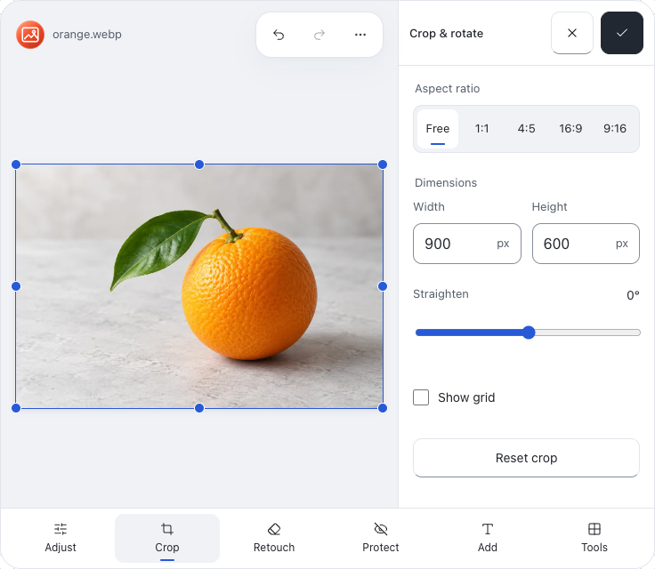

# CloakIMG canvas-first study — 2026-11-02

Status: mock approved by the user on 2026-11-02. Implementation is deferred until
2026-11-03 (Asia/Kolkata), at the user's request. Application source, the Air 1.3.3
contract and deployments are unchanged. This direction supersedes the preceding
More controls / Larger photo proposal.

## Direction

Reserve at least 40% of the depicted screen height for the photo viewport. Keep
undo/redo/view options in a small floating group on the same surface as the canvas,
without a full-width toolbar strip. Place one X / tick pair beside the tool title
inside the fixed tool-panel header. The control body scrolls independently; there
is no additional Done button or expansion toggle. Touch actions are 48px.

Tablet places the same inspector beside the canvas. Phone keeps it underneath.
Air's neutral surfaces, monochrome primary action, restrained borders and selected
markers remain. The icon-only completion pair is approved for this CloakIMG touch layout. The
canonical labelled-action contract must be reconciled during implementation. Accessible names and
supplementary tooltips identify Cancel edit / Apply edit.

The mock supports Crop ratios, dimensions, rotation/grid, Adjust previews,
Apply/Cancel, Undo/Redo and original-image viewing. Other tool dock entries retain
context but do not implement the full editor. It uses the existing orange fixture,
brand asset and host Lucide icons, without adding an app dependency.

## Verification

Twelve completed states: Chrome/WebKit × light/dark × depicted 320 × 568,
390 × 844 and 736 × 640 screens. Automated checks confirm photo viewports of
227.19px, 337.59px and 498px respectively, with no horizontal overflow. Scrolling
the controls leaves the photo and action header stationary. Both actions meet the
44px minimum. Crop/Adjust Apply/Cancel and Undo/Redo pass with no runtime errors.
Phone and tablet captures were visually inspected in both themes.

The initial preview harness included its 16px outer padding in the requested
width, producing smaller depicted screens. The final run corrects the wrapper
width and measures the actual screen dimensions above. These are mock checks;
production image-processing/output, keyboard/IME and physical iPhone acceptance
are not covered. All-tool and applicable sibling consistency checks belong to the
implementation deferred until 2026-11-03.

## Handoff

The inline source is:
`/Users/sumitsahoo/.codex/visualizations/2026/10/19/01a152cf-d189-72d1-a5a6-f8b6c6d4555a/cloakimg-canvas-first.html`.
It contains optional host controls for phone/tablet, minimum photo area 40–55% and
appearance. The standalone inspection wrapper is
`/tmp/cloakimg-canvas-first-preview.html`; reproduce it with the visualization
skill's renderer. The verification runner, measurements and selected captures are
under `evidence/img-canvas-study-2026-11-02/`. No production release is part of this
mock request.

## Saved implementation plan — resume 2026-11-03

The user approved this mock and asked to save the work for tomorrow. Do not start
production implementation or deployment on 2026-11-02. This records a deferred
work session; it does not schedule an automatic run or reminder.

1. Read the current RESUME entry, AGENTS.md, CLAUDE.md, DESIGN.md and TODO in Yard
   and the applicable IMG instructions. Confirm checkout state and preserve other
   local work. Use this approved mock as the visual target; do not reopen the
   earlier expand/collapse proposal or the superseded top-level X / tick idea.
2. Reconcile `design/air/contract.md` with the approved touch exception: one
   tool-local Cancel / Apply pair represented by X / tick, fixed beside the title,
   with accessible action names and at least 44px targets (48px in the mock).
   Keep global canvas history/view controls distinct. Define which transaction,
   inspection and output tools need Apply / Cancel versus Close. Retain truthful
   autosave behavior in Resume. Regenerate all portable specifications and check
   synchronization; do not silently replace desktop or unrelated family actions.
3. Implement one bounded IMG layout piece using existing components and Air
   tokens. Start at `src/editor/MobileEditorSurface.tsx`, its canvas/topbar owners
   and `src/style.css`. Reserve at least 40% of visible editor height for the photo
   viewport while controls are open; preserve image aspect ratio. Keep tool header
   and dock stationary, scroll only the control body, and integrate the global
   toolbar into the canvas. Tablet/short landscape may use the side inspector.
   Account for safe areas, dynamic browser chrome, enlarged text and keyboard
   opening. Do not copy mock-only handlers or add a UI library.
4. Preserve all 26 tools, live previews, transaction checkpoints, canvas/layer
   selection, undo/redo, original comparison, import/export, batch, consent,
   recovery and PWA behavior. Remove obsolete expansion state, duplicate actions,
   unused styles and references only after verifying their callers and behavior.
5. Validate every tool and alternate state across desktop/laptop/tablet/phone,
   short landscape, light/dark, enlarged text and breakpoint transitions. Drive
   real Apply/Cancel/re-entry, invalid input, failure/retry, rapid activation,
   tool switching, undo/redo and output journeys. Check fixed action geometry,
   scroll isolation, canvas minimum, focus/keyboard operation and touch targets.
   Compare actual exported pixels/alpha with the deployed baseline. Keep physical
   iPhone/software-keyboard, IME and spoken assistive acceptance distinct from
   emulated WebKit results. Run all applicable unit, build, type, lint, design,
   portability, dead-code and feature gates from the repository instructions.
6. Visually compare related PDF/Resume touch actions and the family chrome against
   Air. Make only applicable consistency changes; record intentional distinctions.
   Refresh truthful README/PWA captures when the resulting UI changes them.
   Update TODO, evidence and RESUME, then commit each passing bounded piece.
   Follow the previously authorized dev → main PR rollout only after applicable
   verification is complete; preserve Drop's unpublished work and other worktrees.
