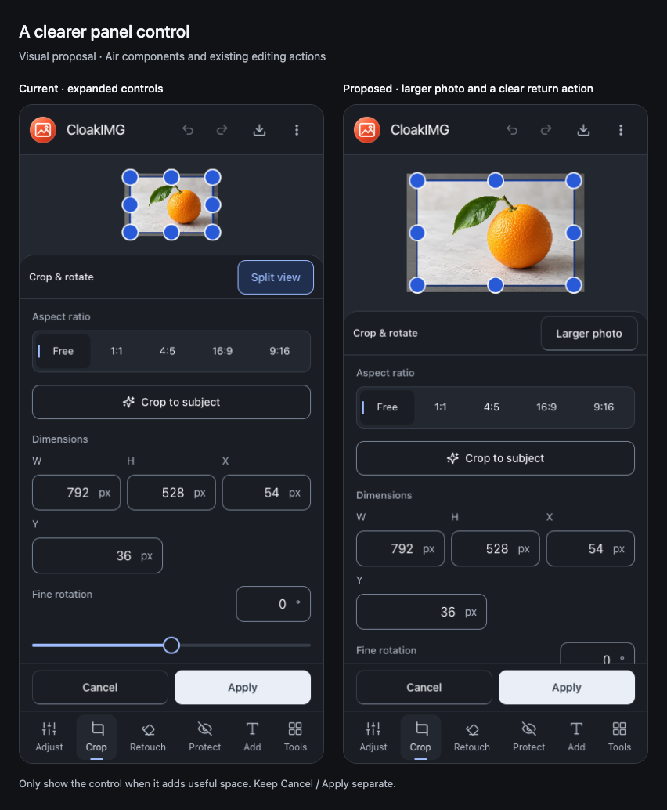

# CloakIMG panel-toggle visual review — 2 November 2026

Status: review and visual proposal complete; application code and the Air 1.3.3
contract are unchanged. This follows the user's request to inspect the awkward
up/down control at the top of an opened tool. The current deployed build already
uses Expand / Split view; an arrow-only open session may be an earlier PWA build,
but the user's device/cache state was not inspected.

## Findings

- `cloakimg/src/editor/MobileEditorSurface.tsx:156`: the quiet text toggle measures
  approximately 83 × 44px, meeting Air's minimum but offering little visible button
  affordance. The return label grows to approximately 98px and shifts the left edge.
- `cloakimg/src/style.css:1087`: landscape uses a fixed side inspector with
  `height: auto`, so toggling the mobile height state cannot change its size. All
  sixteen landscape cases change the label without changing the layout. Four
  portrait Adjust cases likewise expose Expand when their controls already fit.
- `cloakimg/src/editor/MobileEditorSurface.tsx:136`: expanded Crop at 390 × 844
  reduces the photo region from about 321px to 128px. With canvas gutters, the
  image and crop handles become difficult to inspect. On a 320 × 568 phone the
  toggle gains only 24px of panel space.

## Recommended direction

Use Air's neutral secondary button, with More controls / Larger photo labels and
the shared intrinsic label-size reservation. Keep the full labelled button as
the touch target, at least 44px high; the longer wording also widens that target.
A changing action label should not look like a selected mode; expose expansion
state and the controlled panel instead of combining changing verbs with pressed
mode styling. Keep Cancel / Apply separate and fixed.

Only show expansion when the controls overflow and it creates useful extra room.
Remove it from the short landscape inspector and already-fitting panels. Preserve
a usable photo area: the proposal retains 200px at 390 × 844, instead of 128px.
On a short phone that cannot gain useful room while retaining the photo, keep the
normal scrolling panel rather than offer a nearly ineffective expansion. Exact
thresholds would need enlarged-text/keyboard and all-tool validation in an
implementation; 200px is a proposal, not a new family token.

The comparison is a visual-only DOM study of the actual app with the existing
local orange fixture. It introduces no new library or runtime dependency. Any
implementation should update the canonical Air guidance and the PDF sibling's
related view control together where the same behavior applies.

## Review evidence

64 actual deployed states: Chrome and WebKit, light/dark, 320 × 568, 390 × 844,
844 × 390 and 768 × 1024; Adjust, Crop, Resize and Border. The 48 mobile cases
exercise both directions with real taps; 16 tablet cases confirm the separate
inspector. All tap targets meet 44px and the final run has zero browser errors.
Twenty mobile cases produce no size change. Current and proposed phone light/dark
captures were visually inspected. This is a focused review, not a new full-product
acceptance pass or a physical iPhone test.

Initial capture attempts sampled coordinates before asynchronous panel measurement
settled. The final runner waits for stable geometry and resolves the live target
for each tap; those aborted attempts are excluded from the completed matrix.
Full scratch and reproducible review/mock runners:
`/tmp/air-panel-control-review-2026-11-02/`.
