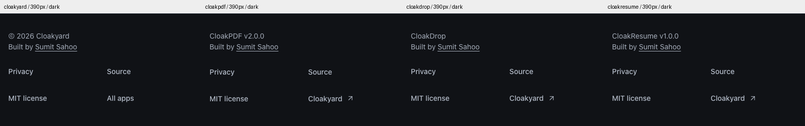
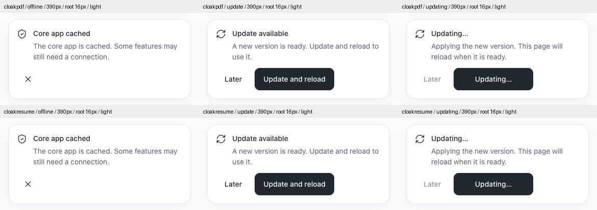

# Footer and PWA consistency audit — 2026-10-26

Status: Air 1.2.3 deployed through four passing dev → main PRs. Production
assets, responsive shells, neutral links and real first-install notices are verified.

The visual audit includes the live websites for Yard, PDF, Drop, Resume and IMG.
Corrections cover the four refreshed websites. IMG's legacy UI remains recorded
as a deviation, with its redesign parked under the existing rollout instruction.
Native Drop, KERR and document/template output are outside this change.

## What the previous audit missed

Air 1.2.2 permitted an extra Yard product-directory row and a Drop Download footer
item. Its tests checked each permitted recipe separately, so they could pass while
footer heights differed. Actual live crops show Yard at 169px desktop/laptop and
279px phone, versus 109px and 219px in PDF/Drop/Resume. Those exceptions are now
removed. The main product directory and Drop's header/download section remain.

The PDF and Resume PWA notices also had separate presentations: a bottom-right
384px PDF card with product-specific headings and Update now, versus an in-flow
Resume banner with Update ready, Update and reload and a redundant close button.
This audit captures actual production app markup with real disposable workers,
including first-install cache, waiting-update and busy states.

IMG's published header, footer and coral update card still use the legacy design.
Its live footer is approximately 487px on phone and 314–329px at the sampled wide
widths. This is an open migration item, not a passing Air surface. Its 15 parked
draft paths remain byte-identical; only the independent portable contract is
maintained locally and verified in an isolated checkout.

## Canonical corrections

- Air 1.2.3 owns one identity/credit group and one four-link footer navigation:
  Privacy → Source → MIT license → Cloakyard. Yard uses All apps for its actual
  directory and Privacy for its existing principles. Copyright and existing app
  versions remain accurate. Source/license destinations remain product-specific.
- Shared 16rem/28rem group bases and container-driven four/two/one-column reflow
  keep natural heights consistent. Padding, type, margins and link ink come from
  Air; there is no fixed footer height or clipped content. All four are 109px at
  the reviewed 1280/1440 widths and 219px at 390px with the standard text size.
- Header task destinations remain product-specific, while marks, typography,
  sizing, compact menus, Source position and angled external-link treatment match.
  All hyperlinks remain neutral on hover and focus; keyboard focus remains visible.
- PDF and Resume import their pinned local `update-notice.tsx`. Common states are
  Core app cached / Update available / Updating… / Update paused. The common
  actions are Later and Update and reload, with Updating… / Try again as needed.
  Cache feedback has one dismiss control; pending updates have no duplicate X.
- The same in-flow panel reserves space above the page/editor. A 45dvh scroll
  boundary keeps the workspace available on short/enlarged screens. Focused
  actions scroll into view; busy actions retain focus; dismissal restores the
  previous surviving focus. Offline expiry pauses during hover/focus in both apps.
- Work-specific instructions remain truthful: PDF defers updates during tasks;
  Resume saves before activation/reload and explains storage failures. Their
  service-worker lifecycles, same-tab consent and cross-tab safeguards remain
  product-owned. Yard and Drop's website do not register a PWA worker and receive
  no fabricated update UI.
- Removed duplicate notice views/styles, PDF toast positioning/keyframes, Yard's
  obsolete footer row/styles and Drop's duplicate footer Download/linkPrefix
  plumbing. The shared module uses exact licensed Lucide SVG paths and React,
  with no new runtime dependency. Standalone bundles remain self-contained.

## Verification and evidence

The revised family test compares heights directly across products at every matching
viewport, theme and text size, in addition to labels, destinations, type, spacing,
keyboard navigation and secondary reading/recovery shells. The new PWA matrix
compares actual notice text, actions, geometry and skin between PDF and Resume.
Real activation/work-preservation suites run separately from stable visual capture.

Evidence is in [the consistency folder](evidence/consistency-2026-10-26/). Initial
live and local crop records cover all five apps. The side-by-side review includes
phone, laptop and desktop light/dark footers, public headers, actual PWA states,
enlarged-text scrolling and IMG's outstanding legacy surfaces. Transient-state
timers are held only for comparison screenshots, not lifecycle verification.

Initial checks are retained rather than relabelled as passes:

- The first portable notice imported lucide-react, unavailable in IMG's isolated
  snapshot. Replaced the import with the same licensed paths; no dependency added.
- Changing Puppeteer's touch profile during navigation reloaded the capture page
  and lost transient notices. Separate fine/coarse contexts fix the test harness.
- PDF's route-race test still searched for Update now. It now selects the approved
  Update and reload label; all work-preservation assertions remain.
- Resume's older PWA/recovery audit treated the inline author credit as a 44px
  button. It now explicitly checks the existing Air inline-credit rule (inline,
  inherited neutral ink, persistent underline); navigation/action hit-area checks
  remain intact. No blanket link exclusion or relaxed action threshold was added.
- The first PDF recovery run could not connect: the local Workers server had
  failed to bind. Restarted it, confirmed a real 404 response and reran the suite.

Existing physical/assistive/device acceptance, PDF Compact beta limitation and
node-forge exception through 2026-11-06, Drop official frozen-runtime exception,
and Resume export intermittency remain open. This shell/PWA audit does not close
the full product migration or certify document-output changes.

Final local results: 1,152 Chrome/Firefox family layouts with zero deviations or
browser errors; 240 shared-notice layouts and 30 exact screenshot pairs; 44 PDF
deferred-update layouts plus real worker/editor/export/cross-tab/race checks;
384 Resume PWA/recovery layouts, all 373 production tests (ten files, zero skips)
and 28 affected tests again after the portable icon substitution; PDF 461 units
and all 16 production smoke suites; 66 actual-host PDF recovery layouts; Resume
349 entry layouts / 14 journeys; Drop 432 layouts / 34 journeys; all four link
matrices. Build, types, formatting/lint, dead-code, contract and 22 portability
checks pass. IMG's isolated maintenance snapshot passes 470 tests/check/build.

## Deployment and production verification

All four main CI and Cloudflare builds pass. All 260 public asset hashes match
the tested builds, with no injected scripts, `no-transform` and correct recovery
responses. Live checks pass 576 family layouts, 432 Drop layouts / 34 journeys,
744 neutral-link states / 250 keyboard checks, and 60 exact local/live render pairs
(48 header/footer and 12 actual first-install PWA panels). The PWA panels use the
production workers; expiry is held only for capture. Waiting-worker activation
and draft preservation were separately verified in local real-worker suites.

| App         | PR                                                        | Merge     | Public assets |
| ----------- | --------------------------------------------------------- | --------- | ------------- |
| cloakyard   | [PR 24](https://github.com/cloakyard/cloakyard/pull/24)   | `1abd9eb` | 13            |
| cloakdrop   | [PR 48](https://github.com/cloakyard/cloakdrop/pull/48)   | `42fd69a` | 16            |
| cloakpdf    | [PR 212](https://github.com/cloakyard/cloakpdf/pull/212)  | `e818ce9` | 130           |
| cloakresume | [PR 45](https://github.com/cloakyard/cloakresume/pull/45) | `45b62f4` | 101           |

The initial immediate PWA crops differed in two PDF references by 14/20 rounded-edge
pixels. All live PDF/Resume pairs matched. Stable-frame local/live captures confirm
all 12 PWA pairs exactly; no application change was required. The initial comparison
is retained rather than counted as a pass.

Drop’s first main build failed while Cloudflare installed tools/dependencies, before
the app build command started. Retried the same `42fd69a` revision through the
dashboard without changing code, lockfiles or build settings. The retry passed;
initial failure and retry identities are retained alongside the final checks.

All four dev branches were fast-forwarded to released main. The documentation-only
closeout follows the same checked PR process and preserves these tested app bytes.
IMG portable maintenance `d630246` remains local and its parked draft is intact.
See [the deployment ledger](evidence/consistency-2026-10-26/deployment.json).
