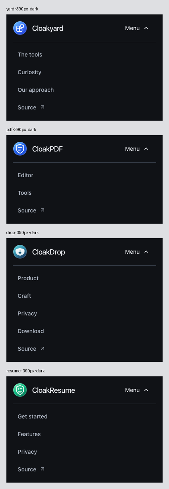
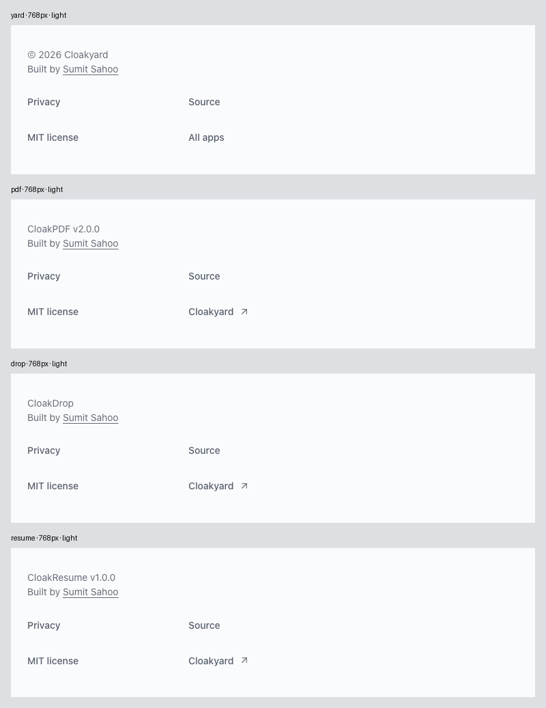
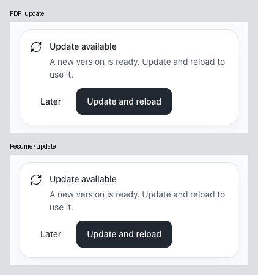

# Responsive consistency audit — 2026-10-28

Status: Air 1.2.4 deployed and production-verified through individual dev → main PRs.

This repeat audit compares Yard, PDF, Drop's website and Resume against the Air
contract and one another. It includes the published IMG site to identify remaining
deviations. IMG's redesign stays parked; only its standalone portable bundle is
maintained locally. Native Drop, KERR, document content and export code are unchanged.

## Findings and refinements

| Before                                                                                                                                                     | After                                                                                                                                                             | Why                                                                                                                                                    |
| ---------------------------------------------------------------------------------------------------------------------------------------------------------- | ----------------------------------------------------------------------------------------------------------------------------------------------------------------- | ------------------------------------------------------------------------------------------------------------------------------------------------------ |
| Production CSS serialized the 900ms light token as `.9s`; `parseFloat` passed 0.9ms to WAAPI. Yard reached idle but the arrival was effectively invisible. | One canonical time conversion handles seconds and milliseconds in the light runtime and reference motion module. Actual production effects are asserted at 900ms. | Completion alone did not prove that the animation was visible. The old live site fails the new duration assertion; all 22 corrected GPU profiles pass. |
| Yard collapsed below 44em, PDF/Drop at 40rem, Resume at 54rem. The initial matrix contained 30 cross-app mode differences.                                 | All four public headers use the same inclusive 40rem container boundary.                                                                                          | Tablet navigation and enlarged-text reflow follow the same recipe without losing product destinations.                                                 |
| Open menu rows had different gaps/padding, Yard's Source arrow sat at the far edge, and Drop's open chevron still pointed down.                            | Air owns row geometry, inline arrow spacing and immediate chevron rotation; redundant app rules are removed.                                                      | A shared implementation and direct comparisons prevent separate passing variants from drifting.                                                        |
| PWA checks omitted 1366px and did not compare every captured notice image.                                                                                 | All eleven viewport classes are exercised; tablet and enlarged-text focus captures are included in 54 exact PDF/Resume pairs.                                     | Same content, geometry and pixels are now tested directly. The existing common notice needs no runtime change.                                         |
| The notice audit loaded Puppeteer through a hardcoded sibling package resolver, producing an unlisted dependency warning.                                  | It uses the existing explicit `PUPPETEER_MODULE` tooling convention.                                                                                              | No new dependency; all four dead-code graphs pass.                                                                                                     |

**Motion verdict: Approve the corrected four-site candidate.** PDF retains its finite
page unveiling and immediate upload entry, Drop assembles FILE/PKG/ISO/ZIP once,
Resume gathers its green storyline, and Yard now has its intended 900ms arrival.
There are no playback controls. Reduced-motion/static fallbacks, hidden/offscreen
suspension and idle behavior remain. These are browser checks, not physical-device
or hardware-power acceptance.

**IMG verdict: Block Air adoption/release.** The published app retains its legacy
header/footer and coral PWA notification, with no adopted Air landing artwork.
This is an explicit open migration item. Its footer remains about 487px at 390px,
427px at 768px and 314–329px at sampled wide widths. The isolated portable update
passes, but does not make the legacy UI an Air pass. All 15 parked paths retain
their initial SHA-256 values.

## Visual comparison

Headers retain product-specific task links while matching their brand row, type,
Source destination pattern, neutral ink and compact behavior. Open menu height is
naturally determined by the number of links. Closed header and footer heights are
compared directly at every matching width/theme/text size. Footers retain the same
identity/credit group and Privacy → Source → MIT license → Cloakyard/All apps recipe.
No fixed heights or clipped text were introduced. Hyperlinks remain neutral on hover.

PDF and Resume continue to share Core app cached, Update available and Updating…
notices, with Later / Update and reload actions. Task deferral, draft saving,
activation consent, errors and focus recovery stay product-owned. Yard and Drop's
website have no service worker and therefore no update dialog. No artificial notice
was added to either website.

## Verification

Evidence: [compressed results, logs and reviewed images](evidence/consistency-2026-10-28/).

- 576 Chrome + 288 Firefox light + 288 Firefox dark public-shell layouts:
  zero deviations or browser errors. Includes secondary privacy/recovery shells,
  200% text and both sides of current and former compact boundaries.
- 264 PWA layouts; 108 captures form 54 exact PDF/Resume pairs, including focused
  enlarged-text actions. Actual update/work-preservation feature tests pass separately.
- All eleven required dimensions in both themes: 320×568, 375×812, 390×844,
  430×932, 844×390, 768×1024, 1024×768, 1280×720, 1366×768, 1440×900, 1920×1080.
  The initial 88 live motion profiles exposed Yard's timing defect; its 22 profiles
  are superseded by corrected production-build GPU timing/idle checks. Twelve Yard
  static cases and all three product artwork suites (68 layouts each) pass.
- PDF: 461 units and all 16 production smoke suites, using the documented generated
  demo fixture mode. No feature/output code changes.
- Resume: 373 production tests across ten files, zero skips, in serial mode;
  28 affected design/PWA tests rerun after compact-menu changes. Entry audit:
  335 layouts and 14 journeys. Product artwork includes eight animated arrivals.
- Drop website: 432 layouts, 34 journeys and 35 captures, with no browser errors
  or unexpected third-party requests. Native app/release artifacts are unchanged.
- 388 neutral-link state checks and 130 keyboard checks across four sites.
- Seven shared-runtime tests, builds, lint/types/formatting, four dead-code graphs,
  synchronized contract checks and 22 portability checks per standalone bundle pass.
- IMG's isolated committed-source-plus-portable-update snapshot: 470 tests in
  46 files, build/check/design/portability, 12 static and 22 GPU cases pass.
  Parked draft source is excluded from this acceptance.

Initial failures remain evidence: urllib received a 403 while Node's normal public
fetch succeeded; the old live timing test correctly fails 0.9 vs 900ms; the first
menu matrix exposed PDF's surviving 16px gap override, then passed after its removal;
Knip exposed the sibling resolver; bundle checks caught stale inventory versions;
and the first PDF smoke run lacked a private scan fixture, so the full command was
rerun successfully with its documented `E2E_DEMO_FIXTURES=1` mode. No assertions
were weakened. Final checks cover the final shared open-chevron rule.

The audit does not close full-product/device acceptance, Resume's existing export
intermittency, PDF's accepted Compact beta long-document limitation or node-forge
exception through 2026-11-06, or Drop's approved official frozen-runtime exception.
Physical touch, software keyboards/IME, spoken assistive technology and hardware
power checks remain open. The build-only dependency follow-up below preserves the tested application bytes.

## Build dependency follow-up

PDF's PR security scan surfaced [GHSA-gcqx-w48m-w2h4](https://github.com/advisories/GHSA-gcqx-w48m-w2h4),
updated on 2026-10-27. The unpatched deepmerge dependency is used by Workbox's
resolver only to clone fixed defaults. PDF/Resume/IMG now pin a minimal CJS/ESM
resolver patch using Node structuredClone and remove deepmerge with a scoped
pnpm override. No new library or advisory suppression was added. Each repository
contains its patch rationale and upstream removal condition. Frozen install,
both resolver entry points, immutable defaults and absence of the removed package
pass; OSV passes with only PDF's existing approved node-forge exception.

IMG's isolated scan additionally found its older serialize-javascript 7.1.2;
the build-only override now uses 7.1.4. Its final OSV scan is clean and 470 tests
pass again. This maintenance remains local. All 130 PDF and 101 Resume public
files and all 101 IMG isolated build files remain byte-identical after these
build-tool changes, including service workers. Existing UI/feature evidence
therefore still applies. The first asset enumeration included a local Resume
`.DS_Store`; it is not deployed (404) and is excluded from public-asset counts.
The earlier failed scan and enumeration are retained as evidence.

## Deployment and final production proof

All required main checks and Cloudflare builds pass. All 260 public asset hashes
match the tested builds. Live comparisons pass 576 public/secondary layouts with
zero deviations or browser errors, 80 exact local/live header/footer/menu pairs,
eight exact live PDF/Resume first-install notice pairs and eight exact local/live
settled Yard GPU artwork pairs. Yard's live duration is 900ms in all 22 GPU
profiles, with 12 static profiles also passing. The actual first-install notices
use production workers; their expiry is held only for capture. Waiting-update,
saving, task deferral and activation safety were verified separately by the
feature suites and 264-layout common-notice matrix.

| App          | PR                                                                                                             | Final main | Public assets |
| ------------ | -------------------------------------------------------------------------------------------------------------- | ---------- | ------------- |
| Yard         | [26](https://github.com/cloakyard/cloakyard/pull/26)                                                           | `75ea6cf`  | 13            |
| PDF          | [213](https://github.com/cloakyard/cloakpdf/pull/213)                                                          | `9276c8a`  | 130           |
| Drop website | [49](https://github.com/cloakyard/cloakdrop/pull/49)                                                           | `34c996f`  | 16            |
| Resume       | [46](https://github.com/cloakyard/cloakresume/pull/46), [47](https://github.com/cloakyard/cloakresume/pull/47) | `010faf8`  | 101           |

Cloudflare stalled before application builds: Resume's superseded `ab63f55`
preview was cancelled during cloning; its subsequent documentation preview failed
fetching the repository. PDF's original main build stalled initializing and was
cancelled/retried at the identical `9276c8a` revision. Retry
`6d040a1f-abe3-4283-b137-f8a8f6ae4d4d` succeeded; Resume's queued main build
`261ce958-7a17-45c1-bb9d-76a0c0b6ef3f` also succeeded. No app code, deployment
settings or permission changes were needed for these infrastructure failures.
The proposed prebuilt-version fallback was not used. Initial outcomes and the
successful main checks are preserved in the evidence.

PDF/Drop/Resume dev branches match released main. Yard's documentation-only
closeout follows the same PR/check/merge/sync sequence and preserves the tested
application bytes. The release ledger records exact identities. IMG maintenance
commits `a220a94` and `338c206` remain local; all 15 parked draft paths match the
saved hashes. All five task-owned preview ports and both audit browser tabs are
closed. No ongoing local service is required.
