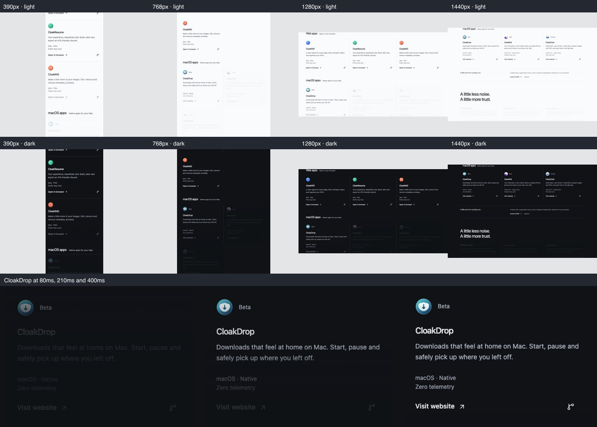

# Cloakyard landing reveals

Air 1.8.0 applies the approved combined reveal to eleven homepage blocks. A
feathered wipe, a 4px lift and a fade run together on a 520ms ease-out curve.
When several items enter together, each starts 240ms after its predecessor in
reading order. The divider and surrounding layout stay still.

At 1280px in Chromium dark mode, the CloakDrop frames captured at 80ms, 210ms
and 400ms matched the corresponding approved preview frames pixel for pixel.

## Browser coverage

| Surface or interaction                                                | Verification                                                                                                                                                                                                                                                                                                           |
| --------------------------------------------------------------------- | ---------------------------------------------------------------------------------------------------------------------------------------------------------------------------------------------------------------------------------------------------------------------------------------------------------------------- |
| Six directory entries, curiosity, three principles and the invitation | Scrolling through the built homepage triggered each below-fold block in reading order. Scrolling back kept settled content visible.                                                                                                                                                                                    |
| Responsive layout                                                     | Chromium, WebKit and Firefox each covered 22 viewport sizes in both themes, from 320px to 2560px, including landscape and the 640px, 704px and 960px breakpoint boundaries. All three engines showed simultaneous intermediate wipe, opacity and lift values. Chromium and WebKit also verified adjacent start delays. |
| Navigation and accessibility                                          | Keyboard focus and section links exposed their destinations immediately. The history return from privacy showed settled content. Reduced motion, print and emulated forced colours showed static content. The plain directory links worked with JavaScript disabled.                                                   |
| Input and reflow                                                      | Wheel scrolling, fast traversal, emulated touch, a portrait-to-landscape resize, longer text and 200% root text passed. Physical devices and spoken screen readers remain open.                                                                                                                                        |

## Release checks

The homepage growth suite covered 44 static layouts, 22 artwork arrivals and four
journeys. The homepage and privacy link suite passed 256 layout and state checks
and 96 keyboard checks. The production JavaScript entry measured 77.09 kB gzip
against the 85 kB limit.

Run `node scripts/test-air-landing-reveals.mjs` against the built site with
`SITE_URL`, the external `PLAYWRIGHT_MODULE`, and `AIR_BROWSER=chromium` or
`webkit`. Set `AIR_EVIDENCE_DIR` to retain captures and per-viewport measurements.
The family contract and generated bundles were checked in an isolated family
directory. Sibling landing pages have their own adoption and release reviews.
